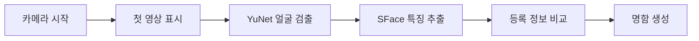

# Android 태블릿의 얼굴 인식 화면 멈춤 개선

[← 프로젝트 소개](../README.md) · [전체 개발 사례](DEVELOPMENT.md)

## 무엇이 문제였나?

**Galaxy Tab A7(SM-T500)**에서 명함보기 화면에 처음 들어갈 때, 화면이 약 26초 동안 멈추는 사례가 발생했습니다. 얼굴을 등록한 직후 명함보기로 넘어가도 비슷한 정지가 발생했고, 인식 과정에서도 간헐적으로 화면이 끊겼습니다.

단순히 AI 모델을 더 가볍게 바꾸는 대신 **어느 단계에서 화면이 막히는지**부터 분리해 측정했습니다.

### 검증 환경

- Unity **6000.5.4f1**, C#, Unity Inference Engine **2.6.1**
- Samsung Galaxy Tab A7 **SM-T500**, Android 11, OpenGLES3
- YuNet 얼굴 검출 → OpenCV 정렬 → SFace 얼굴 특징 추출 → SQLite 비교 → 명함 표시
- 출처: 원본 APPPOFO 개발 과정의 **2026년 10월 12일 Android Development Build 측정 기록**

## 원인을 어떻게 구분했나?

모든 지연을 '추론 시간'이라는 하나의 숫자로 묶지 않았습니다. **영상 프레임이 실제로 멈춘 시간**과 **AI 작업 시작~종료의 전체 경과 시간**도 구분했습니다.

| 원본 개발 로그의 측정 지점 | 문제 경로 관측 |
|---|---:|
| YuNet GPU 입력 변환 | 약 **25.99초** |
| SFace GPU 첫 스케줄 | 약 **26.39초** |
| SFace 구간 최대 프레임 정지 | **26,438.4ms** |
| 별도 GPU 경로 첫 명함 생성 | **29.66초** |

각 수치는 **서로 다른 단계/실험 로그의 기록**이므로 합산하거나 하나의 통제된 측정 세트로 비교하지 않습니다.

## 적용한 해결 방식

### 1. 카메라 화면부터 보여주기

카메라의 첫 영상이 사용자에게 보인 뒤 인식 모델을 순차 준비하도록 구성했습니다. 무거운 AI 초기화를 기다리는 동안 화면이 완전히 멈춘 것처럼 보이는 문제를 줄이기 위한 선택입니다.

[관련 코드: FaceRecognitionCamera](../Assets/AppPofo/Presentation/FaceRecognition/FaceRecognitionCamera.cs)

### 2. SM-T500에서는 CPU 분할 추론 사용

GPU가 언제나 더 빠른 것은 아니었습니다. 이 태블릿에서는 GPU 입력 변환과 첫 추론 단계가 오래 걸려 **CPU 경로로 처리하고 여러 화면 프레임에 작업을 나누는 방식**을 채택했습니다.

| 추론 단계 | SM-T500 기본값 | 다른 기기 기본값 |
|---|---|---|
| **YuNet** | CPU / 16레이어씩 프레임에 나눠 처리 | GPU 기준 경로 |
| **SFace** | CPU / 4레이어씩 프레임에 나눠 처리 | GPU 기준 경로 |

**CPU16 / CPU4**의 숫자는 CPU 코어 수나 초당 인식 횟수가 아니라, **한 렌더 프레임에서 진행시키는 모델 레이어 수**입니다. Unity `ScheduleIterable()`과 Coroutine 흐름으로 작업을 분할한 것으로, 별도 OS 스레드에서 모든 AI를 병렬 실행한다는 의미는 아닙니다.

[기기별 기본 정책](../Assets/AppPofo/Presentation/FaceRegistration/Detection/YuNetExecutionPolicy.cs) · [YuNet 처리](../Assets/AppPofo/Presentation/FaceRegistration/Detection/SentisFaceDetector.cs) · [SFace 처리](../Assets/AppPofo/Presentation/FaceRegistration/Embedding/SFaceRecognizer.cs).

### 3. 등록 → 저장 → 명함까지 통합 확인

원본 개발 로그에는 신규 얼굴의 **정면 10장·좌측 10장·우측 10장** 후보 수집, 특징 벡터 생성과 SQLite 저장, 이후 명함보기에서 동일 프로필을 인식한 과정이 기록되어 있습니다.

카메라 변경·새 세션 진입 시 오래된 인식 결과가 다른 화면에 반영되지 않도록 프레임의 유효 시간과 처리 중단·리소스 정리도 구분했습니다.

## 실제로 어느 정도였나?

| 지표 | 결과 |
|---|---|
| CPU16 경로의 첫 YuNet 검출 | 약 **0.3초** 관측 |
| CPU4 경로의 첫 SFace 추론 | 약 **0.57초** 관측 |
| 별도 CPU16+CPU4 시도 첫 명함 | **1.83초** |
| **신규 등록 이후 명함보기 진입→첫 명함** | **1,442.4ms** (3번째 진입) |
| 같은 검증의 명함보기 구간 | **300ms 초과 FrameGap 기록 없음** |
| 별도 CPU4 명함보기 5회 | **1.83 / 2.87 / 3.60 / 1.47 / 2.73초**, 평균 약 **2.50초** |

**중요한 해석:**
- **1,442.4ms는 신규 얼굴 등록 전체 시간에 포함되지 않습니다.** 명함보기 화면에 들어간 이후부터의 시간입니다.
- 다른 세션·인물·조명 조건의 GPU/CPU 로그이므로 **보장된 전후 개선률을 계산할 수 없습니다.**
- 앱 시작과 등록 카메라 시작에는 일부 **400ms대 프레임 간격**도 있었으므로 앱 전체가 완전히 끊기지 않는다고 말하지 않습니다.
- Release 빌드의 별도 정량 성능 측정, 다른 Android 기기에서의 성능, 대규모 실제 인물 정확도는 확인되지 않았습니다.

## 왜 이 사례가 중요한가?

이 문제는 단순히 AI를 호출하는 코드 문제가 아니라 **하드웨어·앱 화면·모델 추론·데이터 저장·사용자 경험을 함께 고려해야 하는 문제**였습니다.

실제 태블릿에서 문제가 발생한 단계를 로그로 분리했고, 해당 기기에서 효과가 있는 실행 경로를 채택하면서 **다른 기기의 기본 경로는 그대로 유지**했습니다. 그래서 사용 환경에 맞춘 처리 정책과 성능 검증을 함께 설명할 수 있습니다.

관련 테스트: [기기별 실행 정책 테스트](../Assets/AppPofo/Tests/EditMode/YuNetExecutionPolicyTests.cs) · [얼굴 검출 테스트](../Assets/AppPofo/Tests/EditMode/FaceDetectionControllerTests.cs) · [등록 카메라 테스트](../Assets/AppPofo/Tests/PlayMode/FaceRegistrationInputPlayModeTests.cs).

[← README로 돌아가기](../README.md)

