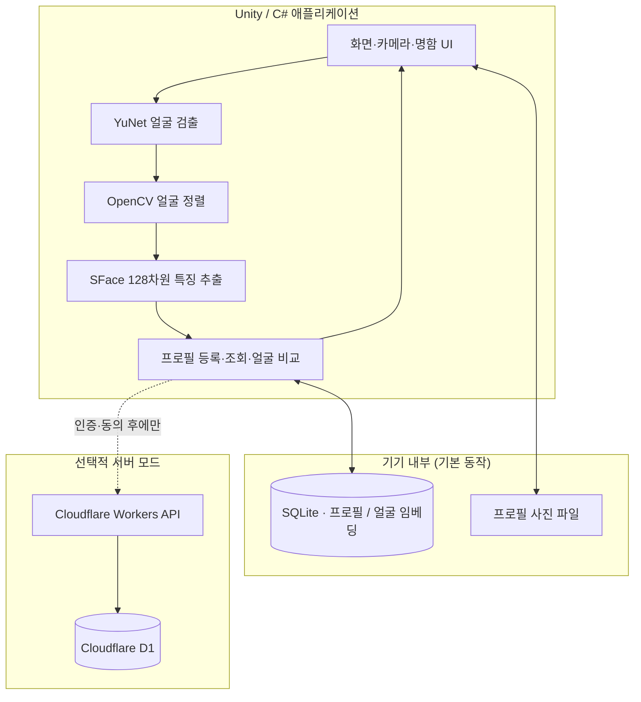
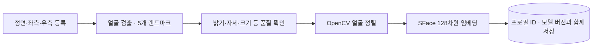
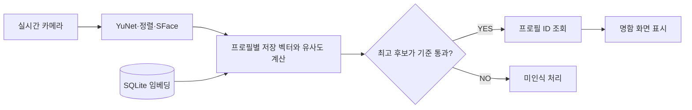

# AppPoFo 구조와 얼굴 인식 처리 방식

[← 프로젝트 소개](../README.md) · [문제 해결](DEVELOPMENT.md) · [실기기 성능 분석](ANDROID_PERFORMANCE.md)

**기획 목표:** 개발자 컨퍼런스나 기술 세미나에서 처음 만난 사람의 기술·프로젝트를 빠르게 소개하고, 교류를 시작할 수 있도록 디지털 명함을 연결합니다. 참가자가 사전에 등록했고 검색을 허용한 프로필을 대상으로 하는 사용 흐름을 가정합니다.

**한 문장 요약:** 카메라에서 얼굴을 찾고 → 얼굴 특징을 추출하고 → 등록된 사람과 비교해 → 그 사람의 명함을 화면에 보여줍니다.

## 1. 전체 구성

로컬 모드는 서버 없이 동작합니다. 서버 모드를 사용하더라도 얼굴의 **위치 검출·특징 추출은 앱에서 처리**하고, 서버는 공개 프로필 검색을 담당합니다. 이 두 모드의 DB는 자동으로 동기화되지 않습니다.

## 2. 얼굴 등록: 사진에서 비교할 특징 만들기

**랜드마크**는 눈·코·입처럼 얼굴의 위치를 맞추는 데 쓰는 기준점입니다. **임베딩**은 얼굴을 비교할 수 있도록 바꾼 숫자 묶음입니다.

- **YuNet:** 얼굴의 위치와 주요 지점을 찾습니다.
- **OpenCV:** 얼굴 각도·위치를 보정해 모델이 일정한 형태로 입력받도록 합니다.
- **SFace:** 정렬된 얼굴을 128차원 벡터로 바꾸고 크기를 정규화합니다.
- **SQLite:** 프로필과 연결된 등록 벡터를 저장합니다. 등록된 이미지 자체를 픽셀 단위로 맞춰 보는 방식은 아닙니다.

실제 파일: [등록 카메라](../Assets/AppPofo/Presentation/FaceRegistration/FaceRegistrationCamera.cs), [YuNet](../Assets/AppPofo/Presentation/FaceRegistration/Detection/SentisFaceDetector.cs), [얼굴 정렬](../Assets/AppPofo/Presentation/FaceRegistration/Alignment/FaceAligner.cs), [SFace](../Assets/AppPofo/Presentation/FaceRegistration/Embedding/SFaceRecognizer.cs), [SQLite 임베딩 저장소](../Assets/AppPofo/Infrastructure/SQLite/Repositories/SQLiteFaceEmbeddingRepository.cs).

## 3. 얼굴 인식: 누구의 명함인지 결정하기

**로컬 비교 로직은 다음 순서입니다.**

1. SFace 출력 벡터를 **128차원인지 검사하고 L2 정규화**합니다.
2. 입력 벡터와 등록 벡터의 **코사인 유사도**를 계산합니다. 정규화된 벡터끼리는 내적을 사용합니다.
3. 정면·좌·우 등 같은 사람의 등록 기록이 여러 개라면 **그 프로필의 최고 점수**를 선택합니다.
4. 전체 프로필에서 가장 높은 점수를 받은 사람을 찾습니다.
5. 유사도 기준을 넘으면 프로필 ID를 명함 UI로 전달합니다.

| 코드 | 책임 |
|---|---|
| [SFaceRecognizer](../Assets/AppPofo/Presentation/FaceRegistration/Embedding/SFaceRecognizer.cs) | 모델 입력·출력, 128차원 검사·정규화 |
| [FaceEmbeddingSimilarity](../Assets/AppPofo/Presentation/FaceRecognition/Matching/FaceEmbeddingSimilarity.cs) | 벡터 유사도 계산 및 프로필별 최고 점수 |
| [FaceRecognitionMatcher](../Assets/AppPofo/Presentation/FaceRecognition/Matching/FaceRecognitionMatcher.cs) | 전체 최고 후보와 임계값 판정 |
| [FaceRecognitionCamera](../Assets/AppPofo/Presentation/FaceRecognition/FaceRecognitionCamera.cs) | 프레임 처리·인식·명함 UI 연결 |
| [BusinessCardPanelController](../Assets/AppPofo/Presentation/Screens/BusinessCardPanelController.cs) | 프로필 조회 후 명함 구성·표시 |
| [ProfileSummaryPanel](../Assets/AppPofo/Presentation/Screens/ProfileSummaryPanel.cs) | 인식한 사람의 상세 프로필 표시 |

현재 로컬 인식 화면의 기본 `recognitionThreshold`는 **0.40**입니다. **인식률 40%가 아니라 코사인 유사도에 적용하는 임계값**이며, 실제 정확도는 별도로 검증해야 합니다. 서버는 별도 후보 간 차이 조건과 인증·동의 정책을 사용하므로 같은 입력이 반드시 동일하게 판정되는 것은 아닙니다.

### 임시 실패 때 명함은 어떻게 할까?

카메라가 한 프레임 동안 얼굴을 놓치거나 인식 처리가 지연될 수 있습니다. 로컬 화면에는 마지막으로 인식한 프로필의 표시를 잠시 유지하는 처리가 있고, 서버 화면에는 짧은 일시적 미인식 허용 시간이 있습니다. **계속 미인식 상태이거나 카메라를 종료하면 표시를 정리**합니다. 서로 다른 모드의 유지 시간을 하나의 고정값으로 단순화하지 않습니다.

## 4. 로컬 모드와 서버 모드 비교

| 구분 | 로컬(기본) | 서버(선택) |
|---|---|---|
| 얼굴 검출·특징 추출 | 앱 | 앱 |
| 인물 비교 | 기기에 저장된 임베딩 | 서버의 공개 동의 데이터 |
| 명함 데이터 | SQLite·기기 로컬 파일 | 서버 공개 프로필 |
| 인터넷 | 필요 없음 | 필요 |
| 로그인·동의 | 로컬 프로필 사용 | 서버 정책에 따른 인증·동의 |
| 주의할 점 | 같은 기기에 등록된 사람 중심 | 서버에 등록·공개한 인물 중심 |

서버 모드가 켜져 있어도 원본 카메라 영상을 그대로 전송하는 구조로 소개하지 않습니다. 서버로 얼굴 **특징값**을 보내 비교하며, 사용자의 동의·접근 권한과 원격 데이터 관리 절차가 별도로 필요합니다.

서버는 [Cloudflare Workers 코드](../cloudflare/apppofo-api/)를 참고하세요. 로컬 SQLite 전체가 암호화되어 있다고 주장하지 않으며, 서버 저장·암호화와 앱 로컬 저장을 구분합니다.

## 5. 소스 구조

| 폴더 | 무엇이 있나 |
|---|---|
| [Presentation](../Assets/AppPofo/Presentation/) | 실제 화면, 카메라, 얼굴 등록·검출·인식, 명함 표시 |
| [Application](../Assets/AppPofo/Application/) | 프로필 생성·조회 같은 앱 동작 |
| [Domain](../Assets/AppPofo/Domain/) | 프로필과 얼굴 임베딩 데이터 정의 |
| [Infrastructure](../Assets/AppPofo/Infrastructure/) | SQLite 연결과 파일 저장 |
| [Tests](../Assets/AppPofo/Tests/) | 주요 기능과 처리 정책의 자동 테스트 |
| [cloudflare/apppofo-api](../cloudflare/apppofo-api/) | 선택적인 원격 API와 데이터 저장 |

이 구조는 앱의 **어떤 화면에서 어떤 데이터가 오가는지** 구분해 수정할 수 있도록 설계했습니다. 얼굴 인식 자체가 실패했을 때와 프로필 조회·명함 표시가 실패했을 때를 따로 확인할 수 있다는 장점이 있습니다.

## 6. 구현·검증에서 중요한 경계

- **사전 학습 모델 재사용:** YuNet과 SFace 학습 코드를 처음부터 작성한 것은 아닙니다.
- **기기별 성능 정책:** Galaxy Tab A7(SM-T500)의 기본 추론 정책은 YuNet CPU16 / SFace CPU4이지만, 다른 기기는 기본 GPU 경로를 사용합니다. [선택 이유와 실측](ANDROID_PERFORMANCE.md)
- **데이터·정확도:** 실제 얼굴을 여러 환경에서 대규모 평가한 FAR/FRR·정확도를 산출한 프로젝트가 아닙니다.
- **공개본 구분:** 원본 Android 실기기 시연과, 공개 소스 사본의 Windows/합성 입력 재현 검증은 서로 다른 증거입니다.

[← README로 돌아가기](../README.md)

