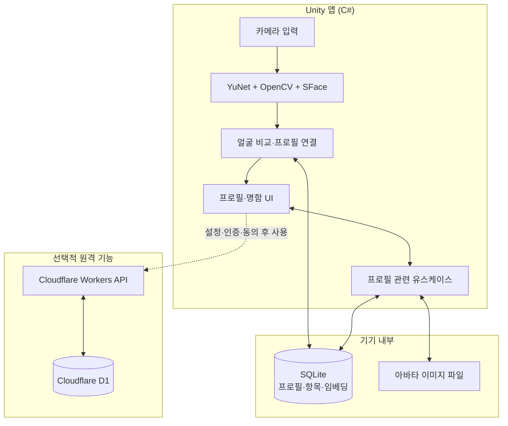
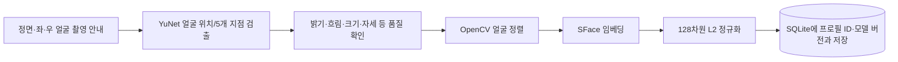
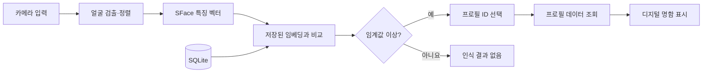

# AppPoFo 시스템 구조

[← 프로젝트 소개](../README.md) · [구현 과정](DEVELOPMENT.md) · [실행 안내](GETTING_STARTED.md)

## 한눈에 보기

AppPoFo는 크게 **화면·카메라**, **얼굴 인식**, **로컬 데이터 저장**, **선택적인 서버 연동**으로 이루어집니다. 얼굴 검출·비교는 기본적으로 기기에서 처리하며, 서버 기능을 사용하지 않아도 로컬 프로필과 명함을 이용할 수 있습니다.



**중요:** 그림의 서버 경로는 선택 사항입니다. 로컬 얼굴 비교와 서버 얼굴 검색은 동일한 경로가 아니며, 서버 검색에는 별도의 소유권·동의·판정 규칙이 적용됩니다.

## 얼굴을 등록할 때



1. 얼굴에서 눈·코·입 주변의 주요 지점을 찾습니다. 이를 **랜드마크**라고 합니다.
2. 얼굴을 일정한 각도로 맞추는 **정렬**을 거칩니다. 위치가 달라도 비교 조건을 일정하게 만들려는 단계입니다.
3. SFace 모델이 얼굴을 **128개 숫자로 된 특징 벡터(임베딩)**로 바꿉니다.
4. 벡터와 해당 프로필의 연결 정보를 SQLite에 저장합니다. 사진 전체를 유사도 계산에 사용하는 방식이 아닙니다.

관련 코드: [얼굴 검출](../Assets/AppPofo/Presentation/FaceRegistration/Detection/SentisFaceDetector.cs) · [정렬](../Assets/AppPofo/Presentation/FaceRegistration/Alignment/FaceAligner.cs) · [임베딩 추출](../Assets/AppPofo/Presentation/FaceRegistration/Embedding/SFaceRecognizer.cs) · [SQLite 저장](../Assets/AppPofo/Infrastructure/SQLite/Repositories/SQLiteFaceEmbeddingRepository.cs)

## 얼굴을 인식할 때



로컬 비교의 핵심은 **코사인 유사도**입니다. 현재 구현에서는 임베딩을 L2 정규화한 뒤 벡터 간 내적을 유사도로 사용합니다. 각 프로필에 임베딩이 여러 개 있다면 가장 높은 점수를 대표값으로 사용하고, 전체 프로필 중 최고 후보가 임계값을 넘는지 확인합니다.

```text
프로필 A: 등록 벡터 3개 → 가장 높은 점수 선택
프로필 B: 등록 벡터 2개 → 가장 높은 점수 선택
                    ↓
          전체에서 최고 후보 선택
                    ↓
      기준 통과 시 프로필과 명함 연결
```

로컬 인식 화면의 기본 설정값은 `recognitionThreshold = 0.40f`입니다. **이는 코드 설정값이지 일반적인 인식 정확도 40%를 뜻하지 않습니다.** 서버에서는 별도의 임계값과 후보 간 점수 차이 조건을 사용하므로 결과가 달라질 수 있습니다.

관련 코드: [유사도 계산](../Assets/AppPofo/Presentation/FaceRecognition/Matching/FaceEmbeddingSimilarity.cs) · [후보 판정](../Assets/AppPofo/Presentation/FaceRecognition/Matching/FaceRecognitionMatcher.cs) · [명함 출력](../Assets/AppPofo/Presentation/Screens/BusinessCardPanelController.cs)

## 코드 구성

| 폴더 | 이해하기 쉬운 설명 |
|---|---|
| `Domain` | 프로필·얼굴 특징 등 핵심 데이터 형태 |
| `Application` | 프로필 생성/조회/수정 등 동작을 조합한 기능 |
| `Infrastructure` | 실제 SQLite 읽기·쓰기, 데이터 변환 |
| `Presentation` | Unity 화면, 카메라, 얼굴 검출·인식 및 명함 표시 |
| `cloudflare/apppofo-api` | 선택적 Workers API와 D1 서버 기능 |
| `Tests` | 등록/검색/화면/저장 등 자동 테스트 |

예를 들어 명함이 표시되는 흐름은 `FaceRecognitionCamera`가 인식 결과를 얻고, 프로필 ID를 통해 `BusinessCardPanelController`가 저장된 정보를 불러와 `BusinessCardView`에 연결하는 식입니다.

## 설계 범위와 주의점

- **모델 개발과 앱 개발은 다릅니다.** YuNet·SFace 사전 학습 모델을 사용하고 모델 입력·출력 및 프로필 연결 로직을 구현한 프로젝트입니다.
- **로컬과 서버 저장은 구분됩니다.** 로컬 SQLite DB 전체가 암호화된다고 주장하지 않습니다. 원격 얼굴 데이터는 서버에서 별도의 암호화 절차를 사용하지만 종단 간 암호화는 아닙니다.
- **측정되지 않은 정확도를 표기하지 않습니다.** 합성 입력의 성공 여부를 실제 인물 집단의 얼굴 인식 성능으로 일반화할 수 없습니다.

[← README로 돌아가기](../README.md)

