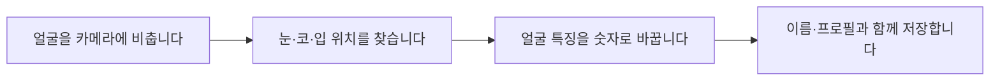
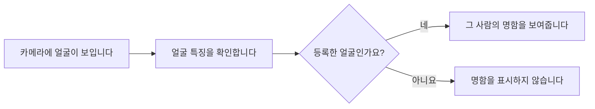
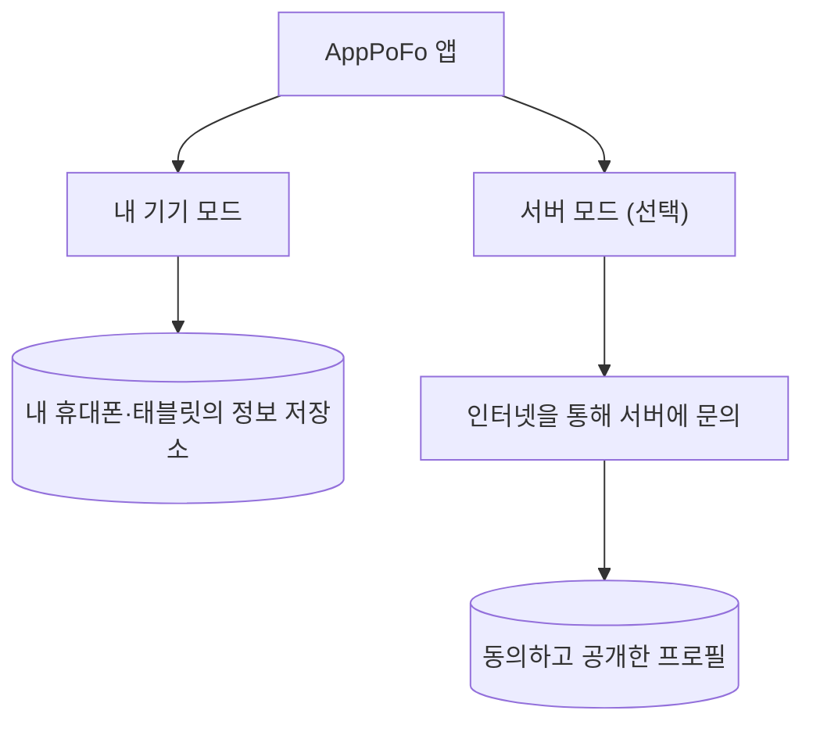

# AppPoFo는 어떻게 사람을 알아볼까요?

[← AppPoFo 소개](../README.md)

기술을 몰라도 이해할 수 있도록 전체 과정을 먼저 설명합니다.

## 1. 얼굴을 등록합니다

사람마다 얼굴 생김새가 다릅니다. AppPoFo는 카메라로 등록한 얼굴에서 비교에 필요한 **특징**을 찾아 저장합니다.

사진을 그대로 서로 맞춰 보는 게 아니라, 얼굴을 비교하기 쉬운 **숫자 형태의 특징값**으로 바꾼다는 점이 중요합니다.

## 2. 명함을 찾아 보여줍니다

사람이 여러 번 얼굴을 등록했다면 그 기록들을 함께 비교합니다. 가장 비슷한 후보를 찾더라도 정해 둔 기준을 통과하지 못하면 다른 사람의 명함을 함부로 띄우지 않도록 합니다.

[실제 얼굴 인식·명함 표시 사진](Images/real-face-recognition.png)

## 3. 정보는 어디에 저장하나요?

- **내 기기 모드**에서는 얼굴과 명함 정보를 기기에 저장해 비교합니다.
- **서버 모드**에서는 별도 설정·인증·동의를 거쳐 공개된 프로필을 찾아볼 수 있습니다.
- 두 모드는 별개입니다. 저장한 프로필이 자동으로 인터넷에 공개되는 것은 아닙니다.

## 조금 더 자세히 알고 싶다면 (개발자용)

| 기술 | 쉬운 설명 | 실제 역할 |
|---|---|---|
| **Unity / C#** | 앱의 화면과 동작을 만드는 도구 | 카메라, 등록, 검색, 명함 UI |
| **YuNet** | 화면에서 얼굴을 찾는 AI | 얼굴 영역·주요 지점 검출 |
| **OpenCV** | 기울어진 얼굴을 가지런히 맞추는 도구 | 얼굴 정렬 |
| **SFace** | 얼굴을 비교 가능한 숫자로 바꾸는 AI | 128개 값의 특징 벡터 추출 |
| **SQLite** | 기기 안의 작은 데이터베이스 | 프로필 및 등록 얼굴 특징 저장 |
| **Cloudflare Workers / D1** | 인터넷으로 정보를 조회하는 서버 | 선택적 공개 프로필 검색 |

**모델을 직접 학습한 것은 아닙니다.** 기존 AI 모델을 앱에 연결하고, 저장해 둔 얼굴과 비교한 뒤 명함으로 보여주는 기능을 구현했습니다.

기술 흐름: `카메라 → YuNet → OpenCV 정렬 → SFace → 유사도 비교 → 프로필 조회 → 명함 표시`

실제 소스: [얼굴 찾기](../Assets/AppPofo/Presentation/FaceRegistration/Detection/SentisFaceDetector.cs) · [특징 추출](../Assets/AppPofo/Presentation/FaceRegistration/Embedding/SFaceRecognizer.cs) · [얼굴 비교](../Assets/AppPofo/Presentation/FaceRecognition/Matching/FaceRecognitionMatcher.cs) · [명함 표시](../Assets/AppPofo/Presentation/Screens/BusinessCardPanelController.cs)

**검증 주의:** 기존 실기기 시연은 있었지만 공개 소스의 신규 Android 빌드를 같은 조건에서 다시 촬영한 것은 아닙니다. 얼굴 인식 테스트가 통과했다고 해서 모든 환경에서의 인식 정확도가 보장되는 것은 아닙니다.

[← README로 돌아가기](../README.md)

