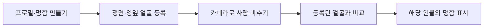
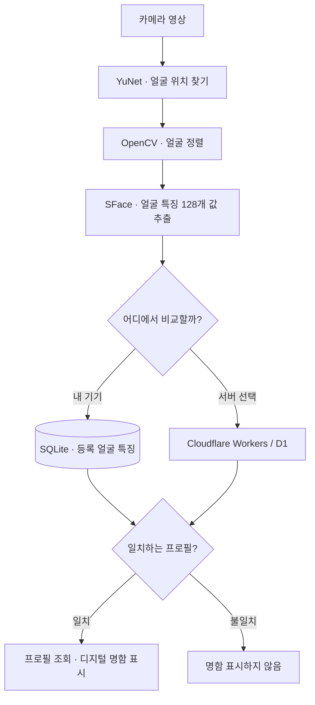

# AppPoFo
### 얼굴을 인식해 그 사람의 디지털 명함을 보여주는 앱

**AppPoFo는 카메라에 보이는 사람이 누구인지 확인하고, 그 사람이 등록한 소개·기술·프로젝트를 명함으로 보여주는 Unity 앱입니다.**

명함을 직접 검색하거나 QR코드를 받는 대신, **등록된 얼굴을 인식하면 해당 인물의 명함이 나타나는 경험**을 구현했습니다. Android 태블릿에서 실제 동작을 확인했으며, 개인 정보는 기기 내부에 저장하거나 사용자의 선택에 따라 서버에서 조회하도록 구분했습니다.

## 1. 실제로 작동하는 모습

<p align="center">
  
</p>
<p align="center"><strong>얼굴 인식 → 등록된 사람의 디지털 명함 표시</strong></p>

2026년 10월 28일 **Samsung Galaxy Tab A7(SM-T500)**에서 촬영한 **실제 앱 실행 화면**입니다. 카메라 화면과 명함 UI는 실제 결과이며, 인물 사진은 공개를 위해 모자이크했습니다. **내 기기(로컬) 모드**의 기존 앱 화면으로, 공개용 소스를 새로 빌드한 촬영본은 아닙니다. [사진 출처와 촬영 범위](Docs/Images/README.md)

## 2. 주요 기능과 사용 흐름



| 주요 기능 | 사용자 입장에서 할 수 있는 일 |
|---|---|
| **프로필 관리** | 이름·사진·소개·기술·프로젝트·링크 등록 및 수정 |
| **얼굴 등록** | 정면·좌측·우측 얼굴을 촬영하고 등록 |
| **실시간 얼굴 인식** | 카메라로 등록된 사람을 찾고 이름·명함 표시 |
| **명함·프로필 상세** | 명함 디자인을 고르고 인식한 사람의 상세 소개 열기 |
| **내 기기 모드** | 인터넷 없이 기기 내부의 등록 정보를 비교 |
| **서버 모드(선택)** | 인증·동의 후 공개된 프로필 검색 |

### 다른 화면도 보기

| 시작 화면 | 프로필·기술 등록 | 명함 미리보기 | 프로필 상세 |
|:---:|:---:|:---:|:---:|
|  |  |  |  |

이 네 장은 **공개 소스의 Unity Play Mode에서 가상 데모 프로필로 촬영한 화면**입니다. 위에 있는 **실제 태블릿 인식 사진**과 출처·촬영 환경이 다릅니다.

## 3. 핵심 기술: 얼굴을 어떻게 명함으로 연결했나?

카메라가 얼굴을 **찾는 일**과 그 얼굴이 **누구인지 판단하는 일**은 다릅니다. AppPoFo는 두 단계를 연결한 다음, 인식 결과를 프로필과 명함에 연결합니다.



**쉬운 설명:** 얼굴의 위치를 찾고 → 각도를 맞추고 → 얼굴을 숫자로 바꾸고 → 저장해 둔 숫자와 비교해 → 일치한 사람의 명함을 보여줍니다.

**개발 관점:** YuNet은 얼굴 위치와 5개 주요 지점을 검출하고, OpenCV는 그 지점으로 얼굴을 정렬합니다. SFace는 **128차원 임베딩(얼굴 특징 벡터)**을 만들며, 로컬 인식은 정규화된 벡터의 **코사인 유사도**를 계산해 프로필별 최고 후보를 선택한 후 임계값을 적용합니다. 서버 인식은 별도의 인증·동의·판정 정책을 사용합니다.

> YuNet·SFace는 **이미 학습된 AI 모델**입니다. 모델 자체를 새로 학습시킨 프로젝트가 아니라, **얼굴 등록 → 특징 추출·저장 → 인물 비교 → 프로필·명함 표시**를 하나의 응용 소프트웨어로 연결하는 데 중점을 뒀습니다.

[그림과 예시로 보는 시스템 구조](Docs/ARCHITECTURE.md)

## 4. 주요 구현 내용과 실제 코드

이 프로젝트에서 개발 역량을 보여주는 부분은 단순한 AI 호출이 아니라, **추론 결과를 실제 사용 기능으로 만드는 C# 애플리케이션 구조**입니다.

| 구현 주제 | 구현한 내용 | 코드 |
|---|---|---|
| **얼굴 검출·정렬** | 영상에서 얼굴·랜드마크를 검출하고 일정한 방향으로 정렬 | [YuNet](Assets/AppPofo/Presentation/FaceRegistration/Detection/SentisFaceDetector.cs) · [정렬](Assets/AppPofo/Presentation/FaceRegistration/Alignment/FaceAligner.cs) |
| **얼굴 특징 추출** | SFace 입력·출력 처리, 128차원 검사, L2 정규화 | [SFaceRecognizer](Assets/AppPofo/Presentation/FaceRegistration/Embedding/SFaceRecognizer.cs) |
| **등록 인물 판별** | 여러 얼굴 특징을 프로필별로 묶어 최고 유사도와 임계값 비교 | [유사도](Assets/AppPofo/Presentation/FaceRecognition/Matching/FaceEmbeddingSimilarity.cs) · [후보 판정](Assets/AppPofo/Presentation/FaceRecognition/Matching/FaceRecognitionMatcher.cs) |
| **데이터 관리** | 얼굴 특징과 프로필을 SQLite에 연결해 저장·조회 | [SQLite 저장소](Assets/AppPofo/Infrastructure/SQLite/Repositories/SQLiteFaceEmbeddingRepository.cs) |
| **인식 → 명함 표시** | 카메라 인식 결과를 프로필 ID와 연결하고 실제 명함 UI 표시 | [인식 화면](Assets/AppPofo/Presentation/FaceRecognition/FaceRecognitionCamera.cs) · [명함 UI](Assets/AppPofo/Presentation/Screens/BusinessCardPanelController.cs) |

**구현 범위의 구분:** 얼굴 인식 결과·임베딩·프로필별 명함 출력을 연결하는 것이 포트폴리오의 핵심입니다. 외부 학습 모델, OpenCV, Unity·SQLite 라이브러리를 새로 만들었다는 의미는 아닙니다. 전체 저장소의 모든 코드를 한 사람이 직접 작성했다고 주장하지도 않습니다.

### 왜 이 기술을 선택했나?

- **Unity + C#:** Android 카메라와 UI, 화면 전환 및 얼굴 인식 결과 표시를 하나의 앱에서 구성하기 위해
- **YuNet + SFace:** 얼굴의 **위치 검출**과 **인물 구별용 특징 추출**을 분리해 재사용하기 위해
- **SQLite:** 별도 서버에 연결하지 않아도 프로필과 등록 얼굴 특징을 보관하기 위해
- **Cloudflare Workers + D1:** 사용자가 선택했을 때만 다른 기기의 공개 프로필 검색으로 확장하기 위해

[더 자세한 기술 구조와 데이터 흐름](Docs/ARCHITECTURE.md)

## 5. 개발 과정에서 해결한 문제

단순히 기능이 동작하는지뿐 아니라, **느린 태블릿에서도 사용할 수 있는지**가 중요한 과제였습니다.

| 문제 | 원인과 개선 | 확인한 결과 |
|---|---|---|
| **첫 인식 화면이 오래 멈춤** | Galaxy Tab A7에서 첫 GPU 처리 경로의 병목을 분리 측정. 카메라 화면을 먼저 보여주고 해당 기기에 CPU 분할 추론 적용 | 개발 로그에서 최대 수십 초 정지 원인을 확인, 신규 등록 이후 명함보기 진입부터 **1.44초**에 첫 명함 표시한 사례 확인 |
| **인식을 잠깐 놓치면 명함 깜빡임** | 한 번의 일시적 인식 실패로 즉시 지우지 않도록 명함 유지 시간 적용 | 기존 테스트·코드로 인식 실패 후 표시 동작 확인 |
| **서버에서 사진 명함이 표시되지 않음** | 사진을 포함한 응답 데이터가 커진 상황의 처리 제한 수정 | 원본 Android 실기기에서 사진 명함 표시 확인 |
| **공개 저장소만으로 실행하기 어려움** | 비공개 DB·키를 제외하고 외부 의존성을 검증 후 설치하도록 분리 | 공개 소스 복원 환경에서 Unity·SQLite·모델 추론·명함 표시 확인 |

**성능 수치 주의:** 1.44초는 **얼굴 등록 시간**이 아니라, 별도 실기기 개발 로그에서 **명함보기 화면에 들어간 뒤 첫 명함이 표시되기까지**의 측정값입니다. 수십 초 정지 사례와 완전히 동일한 조건의 전후 비교나 모든 기기에서 보장하는 수치는 아닙니다.

[Android 성능 문제 분석과 실측 기록](Docs/ANDROID_PERFORMANCE.md) · [문제 해결 과정과 코드](Docs/DEVELOPMENT.md)

## 6. 검증 결과와 한계

| 확인 항목 | 확인 결과와 범위 |
|---|---|
| **실제 Android 동작** | 원본 앱의 Galaxy Tab A7에서 얼굴 등록·실시간 인식·명함 표시 확인 |
| **Unity EditMode** | **531/531 PASS** (기존 Windows Editor 자동 테스트) |
| **Unity PlayMode** | **53/53 PASS** (기존 Windows Editor 자동 테스트) |
| **Cloudflare 서버 테스트** | **85/85 PASS** (로컬·합성 데이터) |
| **공개 소스 실행 재현** | 별도 소스 폴더에서 Unity Play Mode, 실제 모델 추론, SQLite 저장·조회, 명함 UI 확인(합성 얼굴 입력) |
| **추가 검증 필요** | 공개본 새 Android APK의 실기기 실행, 여러 기기·조명 환경의 인식 정확도, 대규모 오인식률 |

자동 테스트의 통과 개수는 **얼굴 인식 정확도**를 의미하지 않습니다. 원본 실기기 사진과 공개 소스 복원 테스트의 조건도 다릅니다.

[자동 테스트 기록](Audit/TEST_RESULTS.json) · [공개본 복원 검증](Audit/CLONE_REPRODUCIBILITY.json)

## 7. 실행 방법

**Unity 6000.5.4f1 · Python 3.9+ · Git**이 필요합니다. 소스 코드를 받은 후 **Unity를 열기 전에** 공식 의존성을 설치해야 합니다.

```powershell
git clone https://github.com/SkyBluekor/APPPOFO-PUBLIC.git
cd APPPOFO-PUBLIC
python tools/setup_dependencies.py --platform Windows --platform Android --accept-upstream-licenses
python tools/setup_optional_tmp.py --accept-unity-sample-terms
```

Unity에서 `Assets/AppPofo/Presentation/Scenes/Bootstrap.unity`를 열고 Play를 누른 다음 **내 기기(로컬)** 모드를 선택합니다.

설치 환경·화면 크기·오류 해결: [처음 실행하는 사람을 위한 안내](Docs/GETTING_STARTED.md)

## 8. 문서 모음

| 문서 | 읽으면 알 수 있는 것 |
|---|---|
| [시스템 구조](Docs/ARCHITECTURE.md) | 등록부터 인식·DB·명함까지 흐름과 코드 구성 |
| [문제 해결 과정](Docs/DEVELOPMENT.md) | 발생한 문제, 원인, 해결 방식과 검증 |
| [Android 실기기 성능 개선](Docs/ANDROID_PERFORMANCE.md) | GPU 병목 진단, CPU16/CPU4 적용과 성능 실측 |
| [실행 방법](Docs/GETTING_STARTED.md) | 로컬에서 프로젝트 복원하고 실행 |
| [사진 자료 설명](Docs/Images/README.md) | 실제 태블릿 촬영 vs Unity 가상 데모 화면 구분 |

<details>
<summary><strong>공개 범위·외부 리소스·상세 검증 기록</strong></summary>

개인정보·운영 데이터베이스·서버 비밀키는 공개 소스에 포함하지 않았습니다. 실기기 얼굴 인식 사진은 원본 프로젝트에서 공개용으로 모자이크한 이미지입니다. 기본 실행은 로컬 모드이며 서버는 선택 사항입니다.

제3자 모델·라이브러리·아이콘의 권리와 배포 조건은 [고지 문서](THIRD_PARTY_NOTICES.md) 및 [이미지 권리 검토](Docs/UI_RIGHTS_REVIEW.md)를 참고하세요. 일부 브랜드 아이콘은 사용 조건 확인이 남아 있습니다. 프로젝트 자체에 대한 일괄 사용 허가 라이선스는 지정하지 않았습니다.

공개 기술·검증 자료: [PUBLIC_READINESS_REPORT](PUBLIC_READINESS_REPORT.md) · [Audit](Audit/) · [상세 의존성](Docs/PUBLIC_SETUP.md) · [문서 안내](Docs/README.md)

</details>

