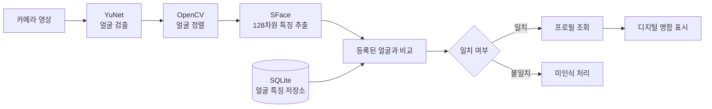

# AppPoFo
### 얼굴을 인식해 디지털 명함을 보여주는 Unity 애플리케이션

카메라에 비친 얼굴을 검출하고, 미리 등록한 얼굴의 특징과 비교해 **해당 인물의 디지털 명함과 포트폴리오**를 표시하는 프로젝트입니다. 얼굴 인식 결과를 사용자 프로필과 연결하는 과정, 기기 내 데이터 저장, 명함 UI까지 하나의 앱으로 구성했습니다.

**기술:** Unity 6000.5.4f1 · C# · YuNet · SFace(ONNX) · OpenCV/OpenCvSharp · SQLite · Cloudflare Workers/D1(선택)

> YuNet과 SFace는 직접 학습한 모델이 아닌 **사전 학습 모델**입니다. 이 프로젝트에서 보여주려는 것은 모델 학습이 아니라 **얼굴 검출·특징 추출·비교 결과를 디지털 명함 기능과 연결한 응용 소프트웨어 개발**입니다.

## 실제 앱 화면

아래 이미지는 공개 소스에서 복원한 Unity 프로젝트의 **실제 Play Mode 화면**입니다. 개인 데이터 대신 새로 만든 데모 프로필을 사용했습니다.

  

<strong>디지털 명함</strong> — 프로필 정보를 불러와 표시하는 화면

| 시작 화면 | 프로필·기술 등록 | 프로필 상세 |
|:---:|:---:|:---:|
|  |  |  |

**시연 범위:** 위 이미지는 실제 앱 UI 캡처이지만 **실제 카메라로 얼굴을 인식해 명함이 표시되는 장면의 영상은 아닙니다.** 독립된 검증 환경에서는 합성 얼굴 데이터로 실제 모델 추론 → SQLite 저장·조회 → 명함 연결 흐름을 확인했습니다. [캡처 설명](Docs/Images/README.md) · [검증 범위](#검증-현황)

## 주요 기능

- **얼굴 등록:** 정면·좌측·우측 안내, 얼굴 품질 확인, 얼굴 특징 벡터 저장
- **얼굴 인식:** YuNet 얼굴 검출, OpenCV 정렬, SFace 임베딩 추출, 등록된 임베딩과 비교
- **디지털 명함:** 인식된 프로필의 이름·소개·기술·프로젝트·링크 조회 및 명함 표시
- **프로필 관리:** 프로필 작성·수정·삭제, 명함 테마 설정, 로컬 SQLite 저장
- **선택적 서버 연동:** 동의·인증 절차를 거치는 Cloudflare Workers/D1 경로. 기본 실행은 로컬 모드

## 어떻게 동작하나요?

얼굴 사진 자체를 직접 비교하는 대신, 모델이 추출한 **128개 숫자로 이루어진 특징 벡터(임베딩)**를 비교합니다. 로컬에서는 정규화된 특징 벡터의 코사인 유사도로 후보를 고르고 임계값을 적용합니다. 원격 인식은 별도 인증·동의 및 판정 정책을 사용합니다.

[구조도와 등록/인식 흐름 자세히 보기](Docs/ARCHITECTURE.md)

## 기술 선택과 구현

| 기술 | 프로젝트에서 맡는 역할 |
|---|---|
| **Unity / C#** | Android·Windows에서 동작하는 화면, 카메라 및 기능 연결 |
| **YuNet** | 영상에서 얼굴 위치와 얼굴 정렬에 필요한 주요 지점 검출 |
| **OpenCV / OpenCvSharp** | 얼굴 위치와 기울기 보정·정렬 |
| **SFace / Unity Inference Engine** | 얼굴을 비교 가능한 128차원 특징 벡터로 변환 |
| **SQLite** | 프로필·프로젝트·기술·얼굴 임베딩을 기기 안에 저장 |
| **Cloudflare Workers / D1** | 선택적으로 프로필과 얼굴 검색을 서버로 확장 |

### 포트폴리오에서 강조하는 구현 범위

핵심 작업은 **얼굴 등록 → 임베딩 저장·비교 → 인식된 프로필 조회 → 명함 UI 표시**를 하나로 연결하는 것입니다. 이 과정은 다음 실제 소스에서 확인할 수 있습니다.

- [얼굴 유사도 계산](Assets/AppPofo/Presentation/FaceRecognition/Matching/FaceEmbeddingSimilarity.cs) · [최적 후보 판정](Assets/AppPofo/Presentation/FaceRecognition/Matching/FaceRecognitionMatcher.cs)
- [SQLite 임베딩 저장소](Assets/AppPofo/Infrastructure/SQLite/Repositories/SQLiteFaceEmbeddingRepository.cs)
- [얼굴 인식 화면](Assets/AppPofo/Presentation/FaceRecognition/FaceRecognitionCamera.cs) · [명함 표시](Assets/AppPofo/Presentation/Screens/BusinessCardPanelController.cs)

기존 모델·라이브러리의 재사용과 애플리케이션 통합을 구분해 설명합니다. 모든 소스나 모델을 혼자 처음부터 개발했다는 의미는 아닙니다.

## 개발 중 다룬 주요 문제

**카메라 시작 지연** — 초기 화면이 보이기 전에 두 추론 Worker를 준비하던 순서를 분리해 먼저 카메라 프레임을 표시하도록 구성했습니다.

**얼굴 비교 기준** — SFace 출력값의 차원과 정규화를 확인하고, 등록된 여러 임베딩을 프로필별로 비교한 후 가장 높은 후보를 선택하도록 구현했습니다. 로컬 임계값과 서버 판정 정책을 같은 것으로 취급하지 않습니다.

**실행 가능한 공개본** — 비공개 프로젝트의 사용자 DB·인증정보·설치 바이너리 없이 공개 소스에서 의존성을 복원하고 앱 UI와 SQLite 연결을 확인했습니다.

→ [문제·원인·코드·검증 근거 보기](Docs/DEVELOPMENT.md)

## 검증 현황

2026-10-29 기준 기존 검증 기록 및 공개 소스 복원 검증 결과입니다. **이번 README 수정으로 앱을 다시 빌드한 결과는 아닙니다.**

| 항목 | 기록된 결과 |
|---|---|
| Unity EditMode / PlayMode | 531/531 · 53/53 통과 |
| Cloudflare 테스트(로컬/합성 데이터) | 85/85 통과 |
| YuNet·SFace 실제 CPU/GPU 추론 | 통과 |
| 공개 소스 복원 후 Play Mode·SQLite·명함 표시 | 통과(합성 얼굴 입력) |
| 새 기기 Android APK 실행·물리 카메라 인식 | **공개본 기준 미검증** |
| 실제 인물 집단의 인식 정확도·오인식률 | **측정하지 않음** |

원문: [테스트 요약](Audit/TEST_RESULTS.json) · [복원/실행 검증](Audit/CLONE_REPRODUCIBILITY.json)

## 실행해 보기

1. **Unity Hub + Unity 6000.5.4f1**, Python 3.9+, Git 준비
2. 저장소 복제 후 **Unity를 열기 전** 공식 의존성 복원
3. `Assets/AppPofo/Presentation/Scenes/Bootstrap.unity`에서 Play 실행
4. 로컬 모드로 프로필 생성 → 명함 확인. 카메라 등록·인식에는 실제 카메라와 권한이 필요

명령어와 오류 해결: **[설치·실행 안내](Docs/GETTING_STARTED.md)**

## 문서

- [시스템 구조와 데이터 흐름](Docs/ARCHITECTURE.md)
- [핵심 구현·문제 해결 과정](Docs/DEVELOPMENT.md)
- [설치 및 실행](Docs/GETTING_STARTED.md)
- [문서 전체 안내](Docs/README.md)

공개 범위·검증 자료·외부 리소스 고지

이 저장소는 개인 포트폴리오를 위한 **소스 공개본**입니다. 사용자 얼굴·프로필·DB·인증정보와 운영 서버 설정은 포함하지 않습니다. 기본값은 로컬 사용이며 외부 API가 자동 연결되지 않습니다.

제3자 리소스는 [권리·라이선스 고지](THIRD_PARTY_NOTICES.md)를 참고하세요. 기존 기술·브랜드 아이콘 일부는 [사용 조건 검토 중](Docs/UI_RIGHTS_REVIEW.md)이며, 특정 기업의 인증·후원·제휴를 뜻하지 않습니다. 프로젝트 전체에 적용할 자체 라이선스는 아직 지정하지 않았습니다.

공개 기술 검증의 상세 이력: [기술 보고서](PUBLIC_READINESS_REPORT.md) · [감사/검증 자료](Audit/) · [상세 의존성 안내](Docs/PUBLIC_SETUP.md). 별도 권리 확인이 필요한 파일을 무조건 재배포해도 된다는 뜻은 아닙니다.

