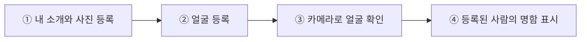

# AppPoFo
### 얼굴을 비추면 그 사람의 명함이 나타나는 앱

**사람의 얼굴을 알아보고, 그 사람이 등록한 명함을 화면에 보여주는 앱을 만들었습니다.**

처음 만난 사람의 이름을 검색하지 않아도, 미리 등록된 얼굴이라면 카메라를 통해 그 사람의 소개와 기술, 프로젝트를 확인할 수 있습니다.

## 실제로 이렇게 작동합니다

  

<strong>실제 태블릿에서 얼굴을 인식하고 명함이 나타난 화면</strong>

얼굴을 카메라에 비추면, 앱이 등록된 사람인지 확인합니다. 일치하는 사람이 있으면 **얼굴 아래에 이름과 소개가 담긴 명함**을 띄워 줍니다.

*삼성 Galaxy Tab A7에서 2026년 10월 28일 직접 촬영한 화면입니다. 개인정보 보호를 위해 얼굴 사진만 모자이크했습니다. 기존 앱의 로컬(내 기기) 모드 시연이며, 새로 공개한 소스를 다시 빌드해 촬영한 화면은 아닙니다.* [사진 설명](Docs/Images/README.md)

## 사용 방법은 간단합니다

카메라를 사용하지 않아도 프로필을 만들고 명함을 미리 볼 수 있습니다.

## 다른 화면도 살펴보세요

| 시작 화면 | 내 소개·기술 등록 | 명함 미리보기 |
|:---:|:---:|:---:|
|  |  |  |

위 세 장은 공개용 Unity 프로젝트에서 만든 **별도의 가상 데모 프로필** 화면입니다. 맨 위 실제 태블릿 얼굴 인식 화면과 동일한 촬영 세션은 아닙니다. [프로필 상세 화면 더 보기](Docs/Images/04-profile-detail.png)

## 어떤 기능이 있나요?

| 기능 | 설명 |
|---|---|
| **내 명함 만들기** | 이름, 소개, 사진, 기술, 프로젝트와 링크를 등록합니다. |
| **얼굴 등록하기** | 카메라로 정면과 양옆 얼굴을 등록합니다. |
| **얼굴로 명함 찾기** | 카메라가 등록된 사람을 알아보면 명함을 보여 줍니다. |
| **명함 꾸미기** | 사진과 디자인을 선택하고 내용을 수정합니다. |
| **내 기기에 저장하기** | 인터넷 없이 사용할 수 있도록 프로필과 얼굴 정보를 기기에 보관합니다. |
| **서버에서 찾기** | 별도 설정과 동의 후 다른 기기에서도 공개된 프로필을 검색할 수 있습니다. |

## 이 앱을 만들며 고민한 점

단순히 얼굴을 찾아내는 것만으로는 명함 앱이 되지 않습니다. **누구의 얼굴인지 확인하고, 그 사람의 정보가 정확한 명함으로 연결되어야** 합니다.

개발하면서 이런 문제도 다뤘습니다.

- **카메라가 처음 켜질 때 오래 멈추는 문제** — 얼굴 인식 준비 순서를 조정해 화면이 먼저 보이도록 개선했습니다.
- **인식이 잠깐 끊겨 명함이 깜빡이는 문제** — 잠시 얼굴을 놓쳐도 명함이 바로 사라지지 않도록 처리했습니다.
- **명함에 사진을 넣자 서버 응답을 읽지 못하던 문제** — 이미지가 포함된 더 큰 응답을 처리하도록 수정했습니다.

[어떤 문제를 어떻게 해결했는지 쉽게 읽어보기](Docs/DEVELOPMENT.md)

## 어떻게 만든 앱인가요?

<strong>사용 기술과 작동 원리 보기</strong>

**Unity와 C#**으로 앱을 만들고, **YuNet과 SFace**라는 이미 만들어진 얼굴 인식 AI 모델을 활용했습니다. **OpenCV**로 얼굴을 보기 좋게 맞춘 뒤, 얼굴의 특징을 숫자로 바꿔 등록된 사람과 비교합니다. **SQLite**는 내 기기 안의 명함 정보를 저장합니다. 선택적으로 **Cloudflare** 서버와도 연결할 수 있습니다.

AI 모델 자체를 새로 학습시킨 프로젝트가 아닙니다. **얼굴 등록 → 인물 찾기 → 명함 표시**가 하나의 앱에서 동작하도록 연결한 것이 핵심입니다.

개발에 관심 있는 분을 위한 자세한 자료: [구조와 작동 방식](Docs/ARCHITECTURE.md) · [구현한 코드와 문제 해결](Docs/DEVELOPMENT.md)

## 실행하고 싶다면

Unity **6000.5.4f1**을 사용합니다. 소스 코드를 받은 뒤 필요한 모델·도구를 설치하고, Unity에서 `Bootstrap.unity` 장면을 열어 실행합니다. 기본 설정은 인터넷 연결 없이 작동하는 **내 기기 모드**입니다.

[처음 실행하는 사람을 위한 설치 안내](Docs/GETTING_STARTED.md)

## 프로젝트 정보와 문서

- **형태:** Android 중심의 디지털 명함 애플리케이션 / Unity · C#
- **중요한 구현:** 얼굴 등록, 얼굴 특징 비교, 사람과 명함 연결, 프로필 저장 및 화면 표시
- **검증:** 기존 Unity 자동 테스트 EditMode 531/531, PlayMode 53/53 및 서버 테스트 85/85 통과 기록. **테스트 통과 수치가 실제 사람의 얼굴 인식 정확도를 의미하지는 않습니다.**
- **문서:** [쉽게 보는 시스템 구조](Docs/ARCHITECTURE.md) · [개발 이야기](Docs/DEVELOPMENT.md) · [실행 방법](Docs/GETTING_STARTED.md)

공개 소스·개인정보·외부 이미지 안내

이 저장소는 포트폴리오용으로 준비한 **공개 소스 버전**입니다. 운영 서버 인증정보나 사용자 얼굴 데이터베이스는 포함하지 않습니다. 맨 위 실기기 사진은 별도로 승인된 모자이크 처리 이미지입니다.

모델과 외부 라이브러리는 저작권자의 사용 조건에 따라 별도 설치하거나 고지합니다. 일부 브랜드 이미지의 사용 조건은 아직 [별도 검토 중](Docs/UI_RIGHTS_REVIEW.md)입니다. [외부 자료·라이선스 안내](THIRD_PARTY_NOTICES.md) · [공개본 검증 기록](PUBLIC_READINESS_REPORT.md) · [기술 검증 자료](Audit/) · [전체 문서 안내](Docs/README.md)

